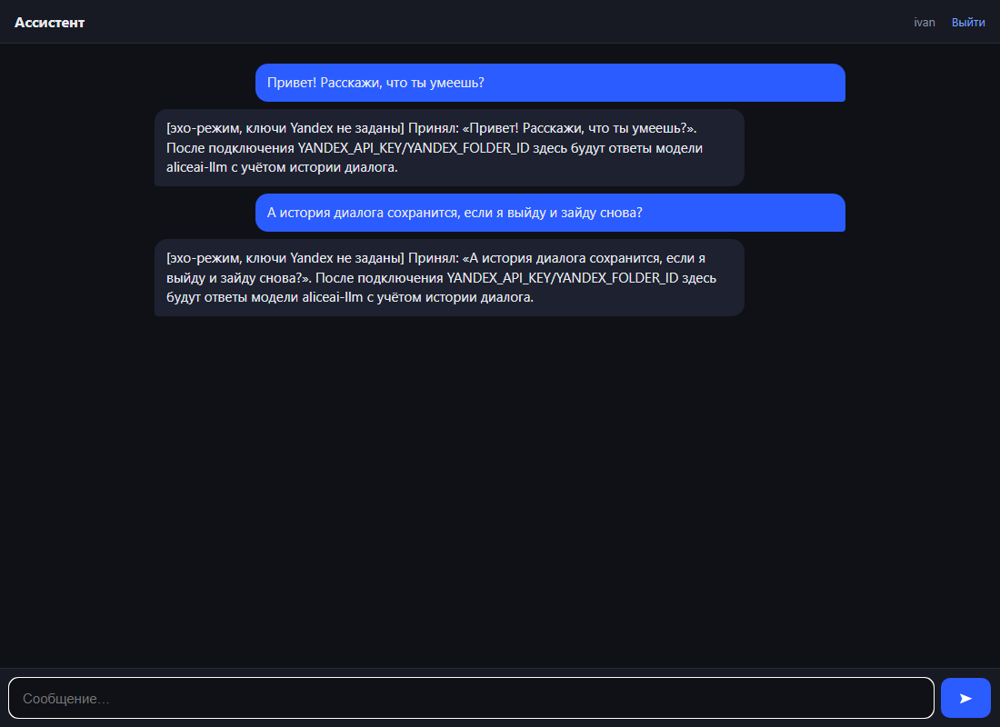
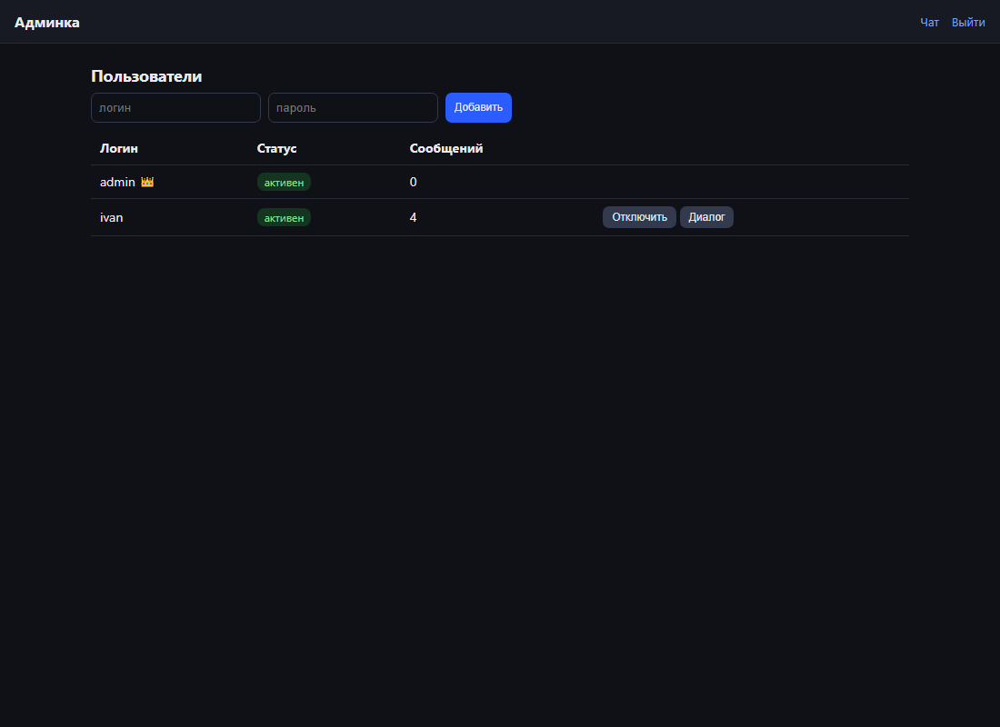

# Private AI Assistant Web Service

A small self-hosted web service that gives each user their own AI assistant —
a private chat with per-user history and context, an admin panel for
managing accounts, and pluggable LLM backends — any OpenAI-compatible API
(OpenAI, OpenRouter, DeepSeek, Ollama, vLLM) or Yandex AI Studio / Alice AI
out of the box.

Built for companies that want an internal ChatGPT-like tool where user
accounts are managed centrally instead of everyone using their personal
accounts on public services.

## Features

- **Browser chat** — works on desktop and mobile, single-file UI.
- **Per-user history** — every user gets their own dialog context.
- **Admin panel** — create/disable users, reset passwords, view dialogs.
- **Echo mode** — without API keys the service runs a stub responder so you
  can verify the whole interface before connecting a real model.
- **SQLite storage** — zero external dependencies beyond Flask + requests.

| Chat | Admin panel |
|------|-------------|
|  |  |

## Quick start

```bash
pip install -r requirements.txt
python app.py          # -> http://127.0.0.1:5000
```

Default admin: `admin` / `admin123` — change via `ADMIN_PASSWORD` env var
(see `.env.example`).

### Docker

```bash
docker build -t ai-assistant-service .
docker run -d -p 5000:5000 --env-file .env -v $(pwd)/data:/app/data ai-assistant-service
```

Or `docker compose up -d` (see `docker-compose.yml`). The SQLite database
persists in `./data`.

## Configuration

Copy `.env.example` to `.env` or export the variables:

- `OPENAI_BASE_URL`, `OPENAI_API_KEY`, `OPENAI_MODEL` — any
  OpenAI-compatible chat API (takes precedence). Point `OPENAI_BASE_URL` at
  OpenRouter, DeepSeek, or a local Ollama/vLLM endpoint.
- `YANDEX_API_KEY`, `YANDEX_FOLDER_ID`, `YANDEX_MODEL` — Yandex AI Studio
  credentials (used when OpenAI vars are not set).
- Leave all model keys empty to run the built-in echo mode.
- `ADMIN_PASSWORD` — initial admin password (first run only).
- `SECRET_KEY` — Flask session key.
- `SYSTEM_PROMPT` — assistant persona.

## Notes

- The SQLite database (`assist.db`) is created automatically on first run —
  users table plus messages table.
- The admin can read user dialogs — this is a company-tool feature
  (compliance), keep it in mind when deploying.
- Single process, no worker queue — fine for dozens of users; put nginx in
  front for TLS.

## License

MIT — see LICENSE.
